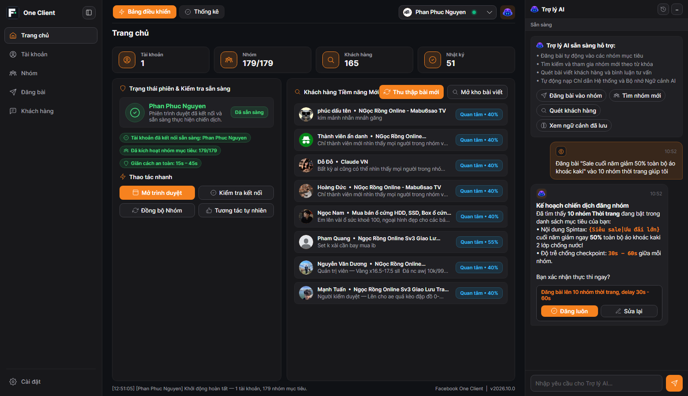
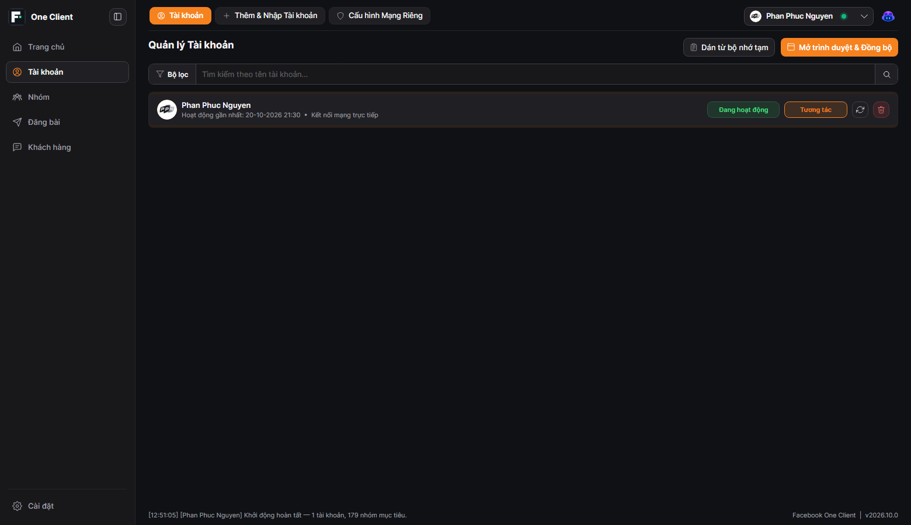
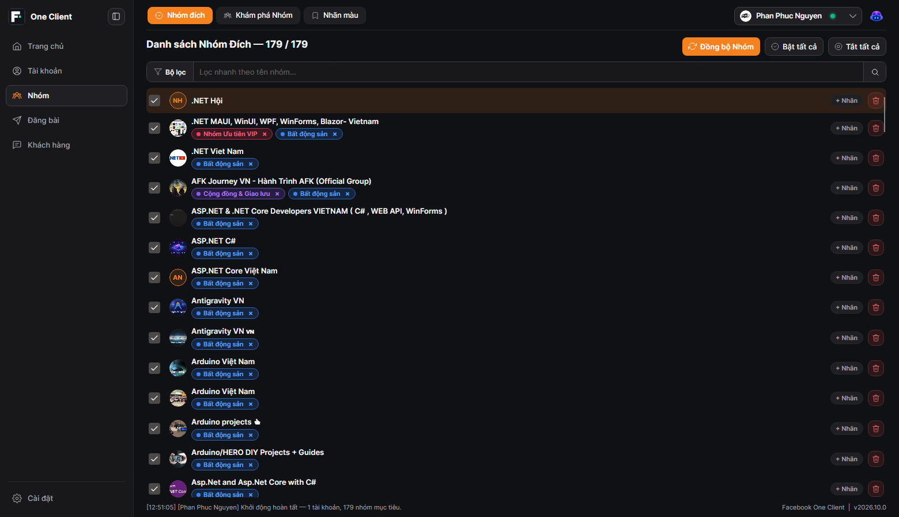
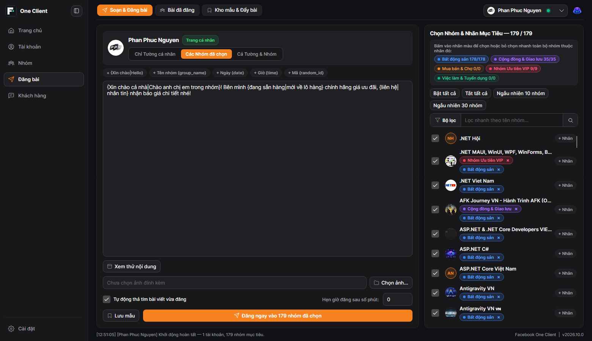
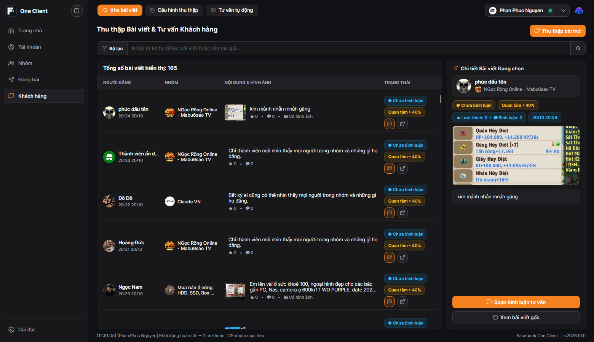
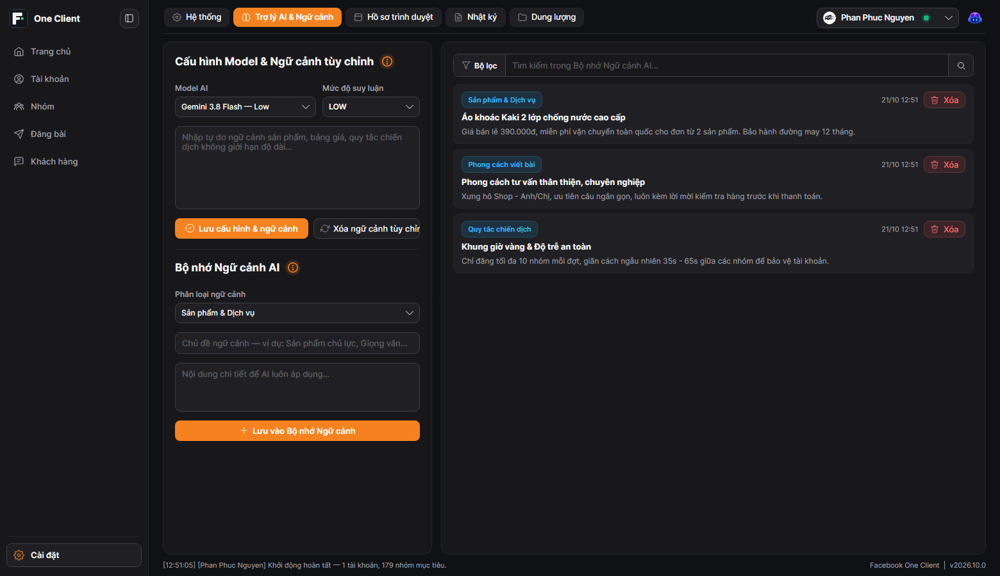

# Facebook.Net — Facebook One Client

Thư viện C# SDK và ứng dụng Desktop **Facebook One Client** hỗ trợ quản lý đa tài khoản, hội nhóm, chiến dịch đăng bài tự động, săn khách hàng tiềm năng và **Trợ lý AI Google Antigravity (`agy`)** trên nền tảng **.NET 10** & **Avalonia UI 12**.



---

## Tính Năng Nổi Bật (Features)

- **Trợ Lý AI Google Antigravity (`agy`) & Bộ Nhớ Ngữ Cảnh (`SQLite FTS5`)**:
  - Tích hợp bảng điều khiển **Trợ lý AI Copilot** ngay trong ứng dụng với luồng phản hồi thời gian thực (`stream-json`), hỗ trợ định dạng Markdown và lưu/khôi phục đa luồng hội thoại.
  - Tự động kết nối máy chủ **Model Context Protocol (`Facebook.Net.Mcp`)** với 27 công cụ chuyên biệt giúp AI nắm bắt tức thì trạng thái tài khoản, nhóm mục tiêu, kho mẫu `Spintax` và đề xuất nút hành động 1 chạm (**Đăng bài**, **Tìm nhóm**, **Quét khách hàng**).
  - Quản lý **System Prompt** tùy chỉnh và **Bộ nhớ Ngữ cảnh AI** (`SQLite FTS5` toàn văn) để AI tự động ghi nhớ sản phẩm, bảng giá, giọng văn thương hiệu và quy tắc chiến dịch qua từng phiên làm việc.
- **Quản Lý Đa Tài Khoản & Proxy**: Đăng nhập trực tiếp trên trình duyệt riêng biệt, nhập nhanh phiên bằng Cookie/JSON, gán Proxy riêng (`HTTP` / `SOCKS5`) và kiểm tra trạng thái hoạt động cho từng tài khoản.
- **Quản Lý Hội Nhóm & Nhãn Màu**: Đồng bộ danh sách nhóm đã tham gia, tìm kiếm và tham gia nhóm mới theo từ khóa, phân loại nhóm mục tiêu bằng nhãn màu trực quan.
- **Soạn Thảo & Đăng Bài Tự Động**: Đăng bài hàng loạt lên các nhóm mục tiêu hoặc trang cá nhân, hỗ trợ trộn nội dung ngẫu nhiên (`Spintax`), xem trước giao diện bài viết mô phỏng Facebook, đính kèm hình ảnh, lưu kho mẫu và tự động bình luận đẩy bài.
- **Săn Khách Hàng & Tư Vấn Bán Hàng**: Quét bài viết mới từ các nhóm mục tiêu, lọc và chấm điểm nhu cầu mua hàng theo từ khóa, xem chi tiết bài viết và tự động bình luận tư vấn chống trùng lặp.
- **Nhật Ký Hoạt Động & Thống Kê**: Theo dõi lịch sử thao tác theo danh mục (Hệ thống, Tài khoản, Hội nhóm, Bài đăng, Bình luận, Quét nhóm, Cá nhân) và quản lý dung lượng lưu trữ hồ sơ trình duyệt.
- **Giao Diện Đa Nền Tảng (Windows & macOS)**: Hỗ trợ bộ cài đặt `.msi` (Windows x64) và `.dmg` (macOS Apple Silicon & Intel), giao diện Sáng / Tối / Theo hệ thống và chuyển đổi ngôn ngữ Tiếng Việt (`vi-VN`) / Tiếng Anh (`en-US`) theo thời gian thực.

---

## Giao Diện Ứng Dụng (Screenshots)

### 1. Bảng Điều Khiển Tổng Quan & Trợ Lý AI Copilot


### 2. Quản Lý Đa Tài Khoản & Proxy Riêng Biệt


### 3. Quản Lý Hội Nhóm & Studio Nhãn Màu


### 4. Soạn Thảo Chiến Dịch Spintax & Mô Phỏng Bài Viết Facebook


### 5. Săn Khách Hàng Tiềm Năng & Tự Động Bình Luận Tư Vấn


### 6. Cài Đặt Hệ Thống & Bộ Nhớ Ngữ Cảnh AI (`SQLite FTS5`)


---

## Solution Architecture

| Dự án | Mô tả vai trò |
| :--- | :--- |
| **`Facebook.Net.Contracts`** | Các mô hình dữ liệu (`AccountProfile`, `SavedTargetGroup`, `PostSummary`, `GroupSummary`, `CampaignTemplate`, `ProxyConfig`) và giao diện chuẩn (`ICometClient`, `IBrowserSession`, `IAccountStore`). |
| **`Facebook.Net`** | Client chính (`CometClient`) thực thi các tính năng lấy bảng tin, quản lý hội nhóm, đăng bài, thả cảm xúc và bình luận. |
| **`Facebook.Net.Browser`** | Quản lý phiên trình duyệt độc lập (`BrowserSessionManager`) và điều khiển trình duyệt đa nền tảng (Windows / macOS). |
| **`Facebook.Net.Storage`** | Lưu trữ dữ liệu cục bộ bằng SQLite (`SqliteAccountStore`, `SqliteAuditLogStore`) cho tài khoản, hội nhóm, bài viết và nhật ký. |
| **`Facebook.Net.Mcp`** | Máy chủ **Model Context Protocol (MCP)** cung cấp 27 công cụ tự động hóa và bộ nhớ ngữ cảnh tích hợp trực tiếp với Antigravity (`agy`), Claude Desktop, ChatGPT và Cursor. |
| **`Facebook.Net.UI.*`** | Hệ thống giao diện người dùng (`Core`, `Components`, `ViewModels`) phục vụ ứng dụng Desktop, bao gồm `AgyCliService` và `SqliteAiMemoryStore`. |
| **`Facebook.Net.App`** | Ứng dụng Desktop **Facebook One Client** (`FacebookOneClient.exe`). |
| **`Facebook.Net.Installer`** | Dự án đóng gói bộ cài đặt Windows `.msi` (WiX Toolset v6 với giao diện Setup Wizard). |

---

## Usage Example

```csharp
using System.Threading;
using Facebook.Net.Browser.Session;
using Facebook.Net.Browser.Windows;
using Facebook.Net.Client;
using Facebook.Net.Contracts.Abstractions;
using Facebook.Net.Contracts.Models;

// 1. Khởi tạo phiên trình duyệt cho tài khoản
using BrowserSessionManager sessionManager = new(new WindowsBrowserAdapter());
IBrowserSession session = await sessionManager.GetOrLaunchSessionAsync(
    new BrowserLaunchOptions(AccountUid: "100000000000000", ProfileDirectory: "./Profiles/acc_01"),
    CancellationToken.None);

using CometClient client = new();

// 2. Lấy danh sách hội nhóm đã tham gia
PagedResult<GroupSummary> groups = await client.GetJoinedGroupsAsync(session, count: 50, ct: CancellationToken.None);

// 3. Đăng bài viết lên nhóm mục tiêu
string? postId = await client.CreateGroupPostAsync(
    session,
    groupId: "123456789",
    spintaxMessage: "{Xin chào|Chào cả nhà}, mình chia sẻ thông tin mới nhé!",
    ct: CancellationToken.None);

// 4. Bình luận tư vấn vào bài viết
await client.CreateCommentAsync(
    session,
    postId: postId!,
    spintaxComment: "Mình đã gửi thông tin chi tiết, bạn kiểm tra tin nhắn nhé!",
    ct: CancellationToken.None);
```

---

## Disclaimer

> **Chú ý**: *Facebook.Net là dự án độc lập được phát triển phục vụ mục đích nghiên cứu học tập và tự động hóa quy trình quản trị cộng đồng. Dự án không trực thuộc, liên kết hay được ủy quyền bởi Meta Platforms, Inc. Người sử dụng tự chịu mọi trách nhiệm tuân thủ Điều khoản dịch vụ của Facebook khi vận hành.*

---

## License & Copyright

Copyright (c) 2026 PPN Corporation. All rights reserved.

Distributed under the [Apache License 2.0](LICENSE).
