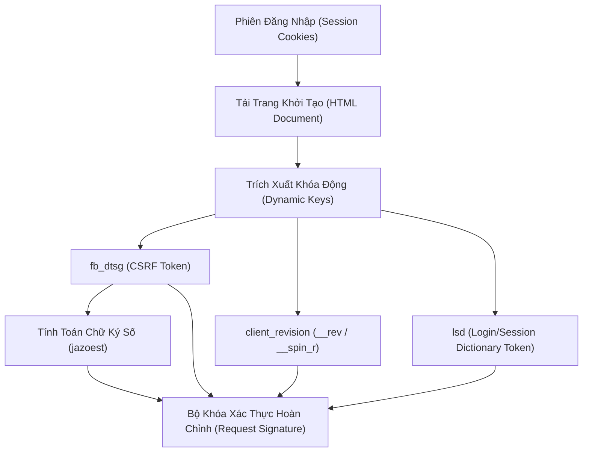
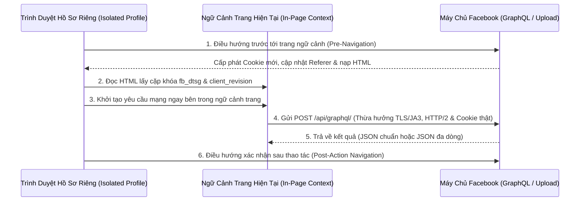
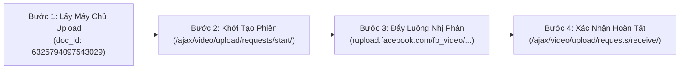

# Nghiên Cứu Chuyên Sâu: Hệ Thống API Keys, Tokens & Các Kỹ Thuật Vận Hành Facebook Comet GraphQL

Tài liệu này tập trung nghiên cứu **thuần túy về kiến trúc giao thức, hệ thống khóa định danh (API Keys / Tokens / Signatures), cấu trúc tham số (Payloads) và các kỹ thuật vượt kiểm duyệt (Anti-Checkpoint)** của nền tảng Facebook Web (Comet), không phụ thuộc vào bất kỳ ngôn ngữ lập trình hay mã nguồn cụ thể nào.

---

## PHẦN 1: HỆ THỐNG KHÓA ĐỊNH DANH & XÁC THỰC (FACEBOOK API KEYS & TOKENS)

Khác với Graph API chính thức (dùng chuỗi `EAAB...` Access Token), giao diện Facebook Desktop hiện đại (tên mã là **Comet**, xây dựng trên kiến trúc **Relay Modern**) sử dụng một **tổ hợp khóa đa tầng** để xác thực và chống giả mạo cho mọi truy vấn tới máy chủ `https://www.facebook.com/api/graphql/`.

### 1.1. Tầng Định Danh Phiên (Session Cookies)
Mọi yêu cầu mạng phải đi kèm cặp khóa phiên cốt lõi trong tiêu đề `Cookie`:
* **`c_user` (Current User ID):** Mã định danh số (UID) của tài khoản đang hoạt động (ví dụ: `1000123456789`). Giá trị này bắt buộc phải khớp hoàn toàn với các trường `av`, `__user`, và `actor_id` bên trong dữ liệu gửi đi.
* **`xs` (Session Secret):** Khóa bí mật phiên đăng nhập. Đi kèm với `datr` (định danh trình duyệt chống gian lận) và `fr` (khóa theo dõi phiên).

### 1.2. Khóa Chống Giả Mạo Yêu Cầu (`fb_dtsg`)
* **Bản chất:** Là khóa bảo mật quan trọng nhất (tương đương CSRF Token / Dynamic API Key) bắt buộc phải có mặt trong mọi phương thức gửi dữ liệu (`POST`) lên Facebook. Khóa này có thời hạn sống nhất định và gắn liền với phiên `xs` hiện tại.
* **Vị trí lưu trữ trên giao diện:** Khi tải trang chủ `https://www.facebook.com/?locale=en_EN`, máy chủ trả về mã nguồn trang chứa khóa này ở hai vị trí:
  1. Thuộc tính giá trị của thẻ ẩn: `fb_dtsg" value="<chuỗi_khóa>"`
  2. Khối dữ liệu khởi tạo ban đầu: `DTSGInitialData",[],{"token":"<chuỗi_khóa>"`

### 1.3. Chữ Ký Kiểm Tra Toàn Vẹn (`jazoest`)
* **Bản chất:** Là chữ ký kiểm tra (Checksum) đi đôi với `fb_dtsg` để đảm bảo khóa `fb_dtsg` không bị sửa đổi ngẫu nhiên trên đường truyền.
* **Quy tắc sinh khóa:**
  1. Lấy toàn bộ các ký tự trong chuỗi `fb_dtsg`.
  2. Chuyển từng ký tự sang giá trị bảng mã chuẩn (ASCII/Unicode thập phân) rồi cộng tổng tất cả lại.
  3. Ghép ký tự số **`2`** vào đầu tổng số vừa tính được (Ví dụ: tổng mã ký tự là `2415` thì `jazoest` sẽ là `22415`).

### 1.4. Khóa Phiên Bản Giao Diện (`client_revision` / `__rev` / `__spin_r`)
* **Bản chất:** Mã số phiên bản phát hành hiện tại của hệ thống Facebook Comet (ví dụ: `1019823456`). Facebook liên tục cập nhật mã nguồn hàng ngày; nếu gửi yêu cầu kèm mã phiên bản quá cũ hoặc lệch giữa `__rev` và `__spin_r`, máy chủ sẽ từ chối hoặc đánh dấu bất thường.
* **Vị trí lưu trữ:** Nằm trong mã nguồn trang ban đầu tại trường `"client_revision":<dãy_số>,`.

### 1.5. Khóa Từ Điển Bảo Mật (`lsd` và tiêu đề `x-fb-lsd`)
* **Bản chất:** Một chuỗi 22 ký tự chữ và số ngẫu nhiên (hoặc trích xuất từ `LSD` trong trang).
* **Quy tắc đối xứng:** Giá trị truyền vào tham số `lsd` ở phần thân yêu cầu (Body) **bắt buộc phải giống hệt** giá trị của tiêu đề `x-fb-lsd` ở phần đầu yêu cầu (Headers).

### 1.6. Khóa Định Danh Ứng Dụng (`x-asbd-id`)
* **Bản chất:** Mã định danh nhánh ứng dụng web của Meta. Đối với giao diện Facebook Comet trên máy tính, tiêu đề `x-asbd-id` luôn mang giá trị cố định là **`359341`**.

### 1.7. Khóa Truy Vấn Cố Định (`doc_id` & `fb_api_req_friendly_name`)
* **Bản chất:** Facebook không cho phép người dùng tự viết câu truy vấn GraphQL tùy ý mà biên dịch sẵn mọi thao tác thành các bản thiết kế lưu trên máy chủ (Persisted Queries).
* **`doc_id`:** Mã số định danh duy nhất (dài 16–17 chữ số) đại diện cho một thao tác cụ thể (ví dụ: gửi kết bạn, thả cảm xúc, đăng bài).
* **`fb_api_req_friendly_name` (và tiêu đề `x-fb-friendly-name`):** Tên định danh của truy vấn tương ứng với `doc_id`. Cả phần tiêu đề (`x-fb-friendly-name`) và phần thân (`fb_api_req_friendly_name`) phải khai báo đồng nhất tên này.

---

## PHẦN 2: BỘ THAM SỐ NỀN & CƠ CHẾ ĐÓNG GÓI DỮ LIỆU (PAYLOAD ARCHITECTURE)

Mọi yêu cầu gọi tới điểm cuối `https://www.facebook.com/api/graphql/` đều phải đính kèm một bộ tham số nền mô phỏng chính xác trạng thái hoạt động của trình duyệt máy tính.

### 2.1. Bảng Giải Mã Chi Tiết Bộ Tham Số Nền (Base Parameters)

| Tên Tham Số | Giá Trị Chuẩn / Quy Tắc Sinh | Vai Trò Trong Hệ Thống Kiểm Duyệt Của Facebook |
| :--- | :--- | :--- |
| `av` | `<UID tài khoản>` | Định danh chủ thể thực hiện hành động (Actor Viewer). |
| `__user` | `<UID tài khoản>` | Định danh người dùng hiện tại của phiên. |
| `__a` | `1` | Cờ báo hiệu yêu cầu bất đồng bộ (AJAX Request). |
| `__dyn` | Chuỗi mã hóa Bitmask dài (~160–200 ký tự) | Danh sách các gói tài nguyên giao diện mà trình duyệt đã tải. |
| `__csr` | Chuỗi rỗng `""` (hoặc chuỗi nén tài nguyên) | Định danh trạng thái bộ nhớ đệm phía trình duyệt. |
| `__req` | Chuỗi 2 ký tự chữ/số ngẫu nhiên (hệ 36/62) | Bộ đếm thứ tự yêu cầu phát sinh trong tab hiện tại. |
| `__beoa` | `0` | Cờ cấu hình môi trường trình duyệt. |
| `__pc` | `EXP2:comet_pkg` | Khai báo gói giao diện đang sử dụng là Facebook Comet Desktop. |
| `dpr` | `1` (hoặc `2`) | Tỷ lệ điểm ảnh của màn hình hiển thị (Device Pixel Ratio). |
| `__ccg` | `EXCELLENT` | Khai báo chất lượng kết nối mạng hiện tại. |
| `__rev` | `<Mã client_revision>` | Phiên bản ứng dụng phía máy khách. |
| `__s` | `<6_ký_tự>:<6_ký_tự>:<6_ký_tự>` | Mã định danh phiên làm việc của tab trình duyệt (Web Session ID). |
| `__hsi` | `6` + `<19_chữ_số_ngẫu_nhiên>` + `-0` | Mã định danh phiên máy chủ (Host Session ID). |
| `__comet_req` | `0` (hoặc `15` tùy loại trang) | Cờ phân loại luồng xử lý của kiến trúc Comet. |
| `fb_dtsg` | `<Khóa fb_dtsg>` | Khóa bảo mật chống giả mạo yêu cầu. |
| `jazoest` | `2` + `<Tổng mã ký tự của fb_dtsg>` | Chữ ký đối chiếu của `fb_dtsg`. |
| `__spin_r` | `<Mã client_revision>` | Phiên bản phát hành (luôn đồng nhất với `__rev`). |
| `__spin_b` | `trunk` | Nhánh phát triển chính của máy chủ Facebook. |
| `__spin_t` | `<Thời gian Unix tính bằng giây>` | Thời điểm khởi tạo phiên trang (Epoch Timestamp in seconds). |
| `server_timestamps` | `true` | Yêu cầu máy chủ sử dụng mốc thời gian chuẩn của hệ thống. |
| `__aaid` | `0` | Định danh tài khoản quảng cáo/phụ trợ. |
| `__hs` | `20223.HYP:comet_pkg.2.1...1` | Chuỗi định danh cấu hình Haste của gói Comet. |
| `__crn` | `comet.fbweb.<Tên_Tuyến_Đường_Trang>` | Tuyến đường (Route) hiện tại trên giao diện (VD: `CometPYMKSuggestionsRoute`). |

### 2.2. Các Khóa Ngữ Cảnh & Chống Trùng Lặp Bên Trong `variables`
Trong trường dữ liệu `variables` (định dạng JSON) gửi kèm mỗi `doc_id`, Facebook kiểm tra nghiêm ngặt các trường ngữ cảnh sau để phân biệt người dùng thật và công cụ tự động:
1. **Chuỗi Truy Vết Hành Vi (`attribution_id_v2`):**
   * Mô tả lịch sử điều hướng của người dùng trước khi bấm nút (Ví dụ: từ Trang chủ -> bấm vào Thanh tìm kiếm -> vào Trang cá nhân -> bấm Kết bạn).
   * Cấu trúc gồm các chặng nối nhau bằng dấu chấm phẩy `;`, mỗi chặng chứa: `<Tên_Thành_Phần_React>,<Tên_Route>,<Cách_Truy_Cập>,<Mốc_Thời_Gian_Mili_Giây>,<Mã_Ngẫu_Nhiên>,<Mã_Bề_Mặt>,,`.
2. **Khóa Chống Lặp Thao Tác (`idempotence_token` & `composer_session_id`):**
   * Định dạng chuẩn UUID v4 (`xxxxxxxx-xxxx-4xxx-yxxx-xxxxxxxxxxxx`).
   * Khi đăng bài viết (`_FEED`) hoặc bình luận (`client:<UUID>`), mỗi thao tác phải sinh một UUID v4 mới hoàn toàn để tránh bị máy chủ gộp thành thao tác trùng lặp.
3. **Bằng Chứng Nhấp Chuột (`click_proof_validation_result`):**
   * Ở các thao tác nhạy cảm như Chấp nhận kết bạn hoặc Từ chối kết bạn, trường này phải mang chuỗi `{"validated":true}`.
4. **Quy Tắc Mã Hóa Định Danh Đối Tượng (Base64 Relay Node ID):**
   * Nhiều truy vấn GraphQL không nhận trực tiếp ID số (`postId`, `userId`, `storyId`) mà yêu cầu chuỗi định danh toàn cục được mã hóa **Base64** theo đúng mẫu tiền tố của Facebook:
     * **Đối tượng tương tác bài viết (Like/Comment/Danh sách người tương tác):** Mã hóa chuỗi `feedback:<PostID>`.
     * **Chi tiết một bài viết đơn lẻ:** Mã hóa chuỗi `S:_I<UID_Của_Mình>:<PostID>:<PostID>`.
     * **Danh sách người theo dõi (Followers):** Mã hóa chuỗi `app_collection:<Target_UID>:2356318349:32`.
     * **Đối tượng Story (Xem/Thả cảm xúc Story):** Mã hóa chuỗi `S:_ISC:<StoryID>`.

---

## PHẦN 3: CÁC KỸ THUẬT VẬN HÀNH & VƯỢT KIỂM DUYỆT (ANTI-CHECKPOINT TECHNIQUES)

Đây là những kỹ thuật cốt lõi giúp quá trình tự động hóa đạt tốc độ của giao thức mạng trực tiếp nhưng giữ nguyên độ tin cậy như thao tác tay của người dùng thật.

### 3.1. Kỹ Thuật "Ủy Quyền Yêu Cầu Nội Trang" (In-Page Request Delegation)
* **Vấn đề của cách gọi mạng truyền thống:** Nếu lấy Cookie và `fb_dtsg` đem ra một công cụ gọi mạng độc lập bên ngoài trình duyệt, Facebook sẽ phát hiện ngay lập tức thông qua **Chữ ký giao thức mạng (TLS/JA3 Fingerprint)** và **Khung truyền tải HTTP/2 - HTTP/3** không khớp với trình duyệt đã khai báo trong `User-Agent`, dẫn đến khóa tài khoản (Checkpoint).
* **Giải pháp kỹ thuật:** Mở một phiên trình duyệt thật (dùng hồ sơ lưu trữ riêng biệt cho từng tài khoản), sau đó **phát lệnh gửi yêu cầu mạng ngay từ bên trong ngữ cảnh của tab trình duyệt đang mở trang Facebook**.
* **Lợi ích tuyệt đối:**
  * Thừa hưởng 100% chữ ký bảo mật TLS/JA3, thứ tự tiêu đề HTTP/2 và bộ nhớ đệm của trình duyệt thật.
  * Tự động đính kèm toàn bộ Cookie bảo mật (`HttpOnly`) và tự động cập nhật khi máy chủ yêu cầu xoay vòng Cookie (`Set-Cookie`).
  * Luôn có tiêu đề `Origin: https://www.facebook.com` và `Sec-Fetch-Site: same-origin` chuẩn xác.

### 3.2. Kỹ Thuật "Đồng Bộ Ngữ Cảnh Điều Hướng" (Contextual Pre/Post Navigation)
Hệ thống chống gian lận của Facebook đối chiếu luồng hành vi giữa **Trang đang xem** và **API đang gọi**:
1. **Điều hướng trước khi gọi API (Pre-Navigation):** Trước khi phát lệnh gọi một `doc_id`, trình duyệt phải chuyển hướng tới đúng địa chỉ URL tương ứng với tính năng đó và chờ mạng ổn định. Ví dụ:
   * Muốn quét gợi ý kết bạn -> Phải mở trang `/friends/suggestions` trước.
   * Muốn gửi/hủy/đồng ý kết bạn với một người -> Phải mở trang cá nhân `/{targetUid}` của người đó trước.
   * Muốn tương tác hoặc bình luận bài viết -> Phải mở trang `/{postId}` trước.
2. **Điều hướng sau khi gọi API (Post-Navigation):** Ngay sau khi nhận phản hồi thành công từ API (ví dụ: gửi kết bạn xong, bình luận xong, hoặc tạo bài viết mới xong), trình duyệt thực hiện tải lại trang đích (`/{targetUid}`, `/{commentId}`, hoặc `/{newPostId}`) để hợp thức hóa nhật ký hiển thị (View/Impression Logging) trên máy chủ Facebook.

### 3.3. Kỹ Thuật "Cầu Nối DOM Ẩn" Khi Tải Lên Tệp Đính Kèm (Hidden DOM File Bridge)
* **Vấn đề:** Trình duyệt chặn không cho phép các yêu cầu mạng tự đọc tệp tin trực tiếp từ ổ cứng máy tính vì lý do bảo mật, và nếu gửi tệp từ bên ngoài trình duyệt thì lại lộ chữ ký mạng khác biệt.
* **Giải pháp kỹ thuật:**
  1. Tạo tạm một phần tử chọn tệp tin (`input file`) ẩn ngay bên trong giao diện trang Facebook đang mở.
  2. Gắn tệp hình ảnh/video từ máy tính vào phần tử ẩn này thông qua cơ chế điều khiển trình duyệt.
  3. Lấy đối tượng tệp nhị phân (`Blob/File`) từ phần tử ẩn đó đóng gói vào biểu mẫu dữ liệu (`FormData`) và gửi thẳng lên máy chủ tải tệp của Facebook ngay trong lòng trình duyệt, sau đó xóa phần tử ẩn đi.

### 3.4. Kỹ Thuật Xử Lý Phản Hồi Đặc Thù Của Facebook (Response Sanitization)
Khi nhận dữ liệu trả về từ máy chủ Facebook, cần áp dụng 2 quy tắc làm sạch dữ liệu:
1. **Cắt bỏ tiền tố chống đánh cắp (`for (;;);`):** Mọi điểm cuối dạng `/ajax/...` (như tải ảnh, khởi tạo tải video) đều gắn chuỗi `for (;;);` ở đầu nội dung phản hồi để chống lỗ hổng JSONP. Cần loại bỏ chính xác 9 ký tự này trước khi phân tích dữ liệu JSON.
2. **Phân tách luồng dữ liệu đa dòng (NDJSON / Multipart Stream):** Với các truy vấn bảng tin lớn như `CometNewsFeedPaginationQuery` (Newsfeed), `GroupsCometFeedRegularStoriesPaginationQuery` (Bài viết nhóm) hoặc `CometVideoHomeFeedSectionPaginationQuery` (Watch), Facebook bật cờ `RELAY_INCREMENTAL_DELIVERY: true`. Máy chủ sẽ trả về **nhiều đối tượng JSON độc lập ngăn cách nhau bởi ký tự xuống dòng (`\n`)** trong cùng một phản hồi:
   * Các dòng đầu chứa danh sách bài viết đầu tiên.
   * Các dòng tiếp theo trả về từng bài viết bổ sung (`data.node`).
   * Dòng cuối cùng chứa thông tin phân trang (`has_next_page` và `end_cursor`) để dùng cho lần quét kế tiếp.

### 3.5. Kỹ Thuật Khởi Tạo Trình Duyệt Tàng Hình & Xếp Hàng Tuần Tự
1. **Xóa dấu vết tự động hóa (Anti-Bot Flags):** Khi khởi chạy trình duyệt cho từng tài khoản, bắt buộc tắt cờ `AutomationControlled` (`--disable-blink-features=AutomationControlled`) và loại bỏ tham số `--enable-automation` mặc định để biến `navigator.webdriver` luôn trả về `false`.
2. **Hàng đợi khởi tạo cách quãng (Staggered Launch Queue):** Không bao giờ mở đồng loạt nhiều trình duyệt trong cùng một giây. Các phiên khởi tạo trình duyệt mới được đưa vào hàng đợi và cách nhau **10 giây** giữa mỗi lần mở để tránh làm nghẽn CPU/ổ cứng và tránh tạo đột biến kết nối mạng cùng lúc trên cùng một địa chỉ IP/Proxy.
3. **Biến thiên nội dung & Nhịp nghỉ thông minh (Spintax & Interruptible Jitter Delay):**
   * Mọi nội dung văn bản (bình luận, bài đăng, tin nhắn) đều đi qua bộ trộn cú pháp `{tùy chọn 1|tùy chọn 2|tùy chọn 3}` hoặc kết hợp AI viết lại văn phong mạng xã hội ngắn gọn (< 50 ký tự) bám sát nội dung bài gốc trước khi gửi.
   * Giữa mỗi thao tác luôn có khoảng nghỉ ngẫu nhiên nằm trong biên độ `[Từ X giây -> Đến Y giây]`, kết hợp nhịp nghỉ 2 giây giữa mỗi trang dữ liệu khi quét phân trang (`cursor`).

---

## PHẦN 4: TỪ ĐIỂN TRA CỨU TOÀN BỘ 27 API GRAPHQL & QUY TRÌNH UPLOAD

Tất cả các API GraphQL dưới đây đều gửi tới `https://www.facebook.com/api/graphql/` bằng phương thức `POST` (`application/x-www-form-urlencoded`).

### 4.1. Nhóm API Kết Bạn, Bạn Bè & Theo Dõi (Friending & Social Graph)

| Chức Năng Nghiệp Vụ | Trang Ngữ Cảnh Cần Mở Trước | Tên Định Danh (`fb_api_req_friendly_name`) | Mã Truy Vấn (`doc_id`) | Cấu Trúc Dữ Liệu Đầu Vào (`variables`) & Dấu Hiệu Thành Công |
| :--- | :--- | :--- | :--- | :--- |
| **Quét danh sách gợi ý kết bạn** | `/friends/suggestions` | `FriendingCometPYMKPanelPaginationQuery` | `9917809191634193` | **Đầu vào:** `{"count":30,"cursor":<null_hoặc_end_cursor>,"location":"FRIENDS_HOME_MAIN","scale":2}` **Đầu ra:** `data.viewer.people_you_may_know.edges[].node.{id, name, profile_picture.uri}` |
| **Quét lời mời kết bạn đã nhận** | `/friends/requests` | `FriendingCometFriendRequestsSectionPanelPaginationQuery` | `24062887186648527` | **Đầu vào:** `{"count":20,"cursor":<cursor>,"scale":2}` **Đầu ra:** `data.viewer.friending_possibilities.edges[].node.{id, name}` |
| **Quét lời mời kết bạn đã gửi đi** | `/friends/requests` | `FriendingCometOutgoingRequestsDialogPaginationQuery` | `9776114965832879` | **Đầu vào:** `{"count":10,"cursor":<cursor>,"scale":2}` **Đầu ra:** `data.viewer.outgoing_friend_requests_connection.edges[].node.{id, name}` |
| **Quét người theo dõi (Followers) của 1 UID** | `/{targetUid}/followers` | `ProfileCometAppCollectionListRendererPaginationQuery` | `24526674566935562` | **Đầu vào:** `{"count":8,"cursor":<cursor>,"scale":2,"search":null,"id": Base64("app_collection:" + targetUid + ":2356318349:32")}` (Lưu ý: `__comet_req="15"`). **Đầu ra:** `data.node.pageItems.edges[].node.node.id` |
| **Gửi lời mời kết bạn** | `/{targetUid}` | `FriendingCometFriendRequestSendMutation` | `9408332592608561` | **Đầu vào:** `{"input":{"attribution_id_v2":"...","click_proof_validation_result":null,"friend_requestee_ids":[targetUid],"friending_channel":"PROFILE_BUTTON","warn_ack_for_ids":[],"actor_id":myUid,"client_mutation_id":"8"},"scale":2}` **Thành công khi:** `friendship_status == "OUTGOING_REQUEST"` |
| **Chấp nhận lời mời kết bạn** | `/{targetUid}` | `FriendingCometFriendRequestConfirmMutation` | `10003720989745533` | **Đầu vào:** `{"input":{"click_proof_validation_result":"{\"validated\":true}","friend_requester_id":targetUid,"friending_channel":"FRIENDS_HOME_REQUESTS","warn_ack":false,"actor_id":myUid,"client_mutation_id":"2"},"scale":2,"refresh_num":0,"should_fix_banner":false}` **Thành công khi:** `friendship_status == "ARE_FRIENDS"` |
| **Từ chối lời mời kết bạn** | `/{targetUid}` | `FriendingCometFriendRequestDeleteMutation` | `9869125063134847` | **Đầu vào:** `{"input":{"click_proof_validation_result":"{\"validated\":true}","friend_requester_id":targetUid,"friending_channel":"FRIENDS_HOME_MAIN","actor_id":myUid,"client_mutation_id":"3"},"scale":2,"refresh_num":0}` **Thành công khi:** `friendship_status == "CAN_REQUEST"` |
| **Thu hồi lời mời kết bạn đã gửi** | `/{targetUid}` | `FriendingCometFriendRequestDeleteMutation` | `7885384641585723` | **Đầu vào:** `{"input":{"attribution_id_v2":"...","cancelled_friend_requestee_id":targetUid,"click_proof_validation_result":null,"friending_channel":"PROFILE_BUTTON","actor_id":myUid,"client_mutation_id":"1"},"scale":2}` **Thành công khi:** `friendship_status == "CAN_REQUEST"` |
| **Hủy kết bạn (Unfriend)** | `/{targetUid}` | `FriendingCometUnfriendMutation` | `23930708339886851` | **Đầu vào:** `{"input":{"source":"bd_profile_button","unfriended_user_id":targetUid,"actor_id":myUid,"client_mutation_id":"1"},"scale":2}` **Thành công khi:** `friendship_status == "CAN_REQUEST"` |
| **Hủy theo dõi (Unfollow)** | `/{targetUid}` | `CometUserUnfollowMutation` | `9829779950432073` | **Đầu vào:** `{"action_render_location":"WWW_COMET_FRIEND_MENU","input":{"attribution_id_v2":"...","is_tracking_encrypted":false,"subscribe_location":"PROFILE","tracking":null,"unsubscribee_id":targetUid,"actor_id":myUid,"client_mutation_id":"1"},"scale":2}` **Thành công khi:** `subscribe_status == "CAN_SUBSCRIBE"` |
| **Chọc bạn bè (Poke)** | `/pokes` | `PokesMutatorPokeMutation` | `29511440545169840` | **Đầu vào:** `{"input":{"client_mutation_id":"4","actor_id":myUid,"user_id":targetUid}}` **Thành công khi:** Có trả về `data.user_poke.user.poke_status` |
| **Lấy danh sách các nhóm Bạn bè (Bạn thân)** | `/friends/friendlist` | `FriendListCometRootQuery` | `29800661609524801` | **Đầu vào:** `{}` **Đầu ra:** Tìm phần tử trong `data.viewer.friend_lists.nodes` có `list_type == "CLOSE_FRIENDS"` để lấy `id`. |
| **Thêm bạn vào danh sách Bạn thân** | `/lists/{listId}` | `useFriendListCometUpdateMembersMutation` | `9980273685337937` | **Đầu vào:** `{"input":{"client_mutation_id":"4","actor_id":myUid,"add_ids":[danh_sách_UID],"close_friends_current_surface":"CFL_EDIT","close_friends_ref":"FRIENDS_TAB","list_id":listId,"remove_ids":[]}}` |

---

### 4.2. Nhóm API Bài Viết, Tương Tác, Bình Luận & Chia Sẻ (Feed, Posts & UFI)

#### Bảng Mã Khóa Cảm Xúc (`feedback_reaction_id`)
Khi gọi API thả cảm xúc bài viết, sử dụng các mã số định danh cố định sau:
* 👍 **Thích (Like):** `1635855486666999`
* ❤️ **Yêu thích (Love):** `1678524932434102`
* 🥰 **Thương thương (Care):** `613557422527858`
* 😆 **Haha:** `115940658764963`
* 😮 **Wow:** `478547315650144`
* 😢 **Buồn (Sad):** `908563459236466`

| Chức Năng Nghiệp Vụ | Trang Ngữ Cảnh | Tên Định Danh (`fb_api_req_friendly_name`) | Mã Truy Vấn (`doc_id`) | Cấu Trúc Dữ Liệu Đầu Vào (`variables`) & Đầu Ra |
| :--- | :--- | :--- | :--- | :--- |
| **Quét bài viết trên Bảng tin (Newsfeed)** | `/` | `CometNewsFeedPaginationQuery` | `9957095364411180` | **Đầu vào:** `count: 5`, `cursor`, `feedLocation: "NEWSFEED"`, `orderby: ["TOP_STORIES"]`, `RELAY_INCREMENTAL_DELIVERY: true`. **Đầu ra:** Phản hồi đa dòng (`\n`), trích xuất `post_id` và `comet_sections.content.story.message.text`. |
| **Lấy nội dung chi tiết 1 bài viết** | `/{postId}` | `CometSinglePostDialogContentQuery` | `24002447362717951` | **Đầu vào:** `storyID: Base64("S:_I" + myUid + ":" + postId + ":" + postId)`, `feedLocation: "PERMALINK"`. **Đầu ra:** Lấy nội dung văn bản bài viết để cung cấp ngữ cảnh cho AI tạo bình luận. |
| **Thả cảm xúc bài viết (React Post)** | `/{postId}` | `CometUFIFeedbackReactMutation` | `9518016021660044` | **Đầu vào:** `feedback_id: Base64("feedback:" + postId)`, `feedback_reaction_id: <Mã_Cảm_Xúc>`, `feedback_source: "NEWS_FEED"`, `session_id: <UUIDv4>`. |
| **Bình luận bài viết ( kèm Text / Ảnh )** | `/{postId}` | `useCometUFICreateCommentMutation` | `9261808033920695` | **Đầu vào:** `feedback_id: Base64("feedback:" + postId)`, `message: {"ranges":[],"text": <Nội_dung>}`, `attachments: [{"media":{"id": <fbid_ảnh>}}]` (hoặc `null` nếu không có ảnh), `idempotence_token: "client:" + <UUIDv4>`. **Đầu ra:** Giải mã Base64 trường `node.id` và tách dấu `_` để lấy `commentId`. |
| **Quét danh sách người đã thả cảm xúc bài viết** | `/{postId}` | `CometUFIReactionsDialogTabContentRefetchQuery` | `9561069197331106` | **Đầu vào:** `count: 10`, `cursor`, `id` và `feedbackTargetID` đều là `Base64("feedback:" + postId)`. **Đầu ra:** `data.node.reactors.edges[].node.{id, name, friendship_status}` |
| **Quét danh sách người đã bình luận bài viết** | `/{postId}` | `CommentsListComponentsPaginationQuery` | `9994312660685367` | **Đầu vào:** `commentsAfterCount: -1`, `commentsAfterCursor: <cursor>`, `id: Base64("feedback:" + postId)`, `commentsIntentToken: "RANKED_UNFILTERED_CHRONOLOGICAL_REPLIES_INTENT_V1"`. **Đầu ra:** `edges[].node.user.{id, name}` |
| **Lấy thông tin nhúng liên kết trước khi Chia sẻ** | `/{postId}` | `ComposerLinkAttachmentPreviewQuery` | `24138745772416942` | **Đầu vào:** `params: {"url": "https://www.facebook.com/" + postId}`. **Đầu ra:** Trích xuất `share_type` từ chuỗi `data.link_preview.share_scrape_data`. |
| **Chia sẻ bài viết lên Tường hoặc vào Nhóm** | `/{postId}` | `ComposerStoryCreateMutation` | `9510250992417785` | **Đầu vào:** Truyền `share_type` lấy từ bước trên vào `attachments[0].link.share_scrape_data`. Nếu chia sẻ lên Tường thì `composer_type: "share"`, nếu vào Nhóm thì `composer_type: "group"` kèm `audience: {"to_id": groupId}`. |
| **Đăng bài viết mới (Kèm nhiều Ảnh / Video)** | `/` hoặc `/{groupId}` | `ComposerStoryCreateMutation` | `30414495441498438` | **Đầu vào:** `attachments` chứa mảng `{"photo":{"id": photoId}}` hoặc `{"video":{"id": videoId, "notify_when_processed": true}}`. Chế độ đăng Tường (`composer_type: "feed"`) hoặc Nhóm (`composer_type: "group"`, `audience: {"to_id": groupId}`). |

---

### 4.3. Nhóm API Hội Nhóm (Groups), Tin (Stories), Watch, Thông Báo & Fanpage

| Chức Năng Nghiệp Vụ | Trang Ngữ Cảnh | Tên Định Danh (`fb_api_req_friendly_name`) | Mã Truy Vấn (`doc_id`) | Ghi Chú Kỹ Thuật & Dữ Liệu Quan Trọng |
| :--- | :--- | :--- | :--- | :--- |
| **Tìm kiếm Hội nhóm theo từ khóa** | `/search/groups/?q={keyword}` | `SearchCometResultsPaginatedResultsQuery` | `9729744383789355` | `experience: {"type": "GROUPS_TAB"}`, `text: <từ_khóa>`, `count: 5`. Lấy `groupId` từ `loggedProfile.id`. |
| **Quét danh sách Nhóm đã tham gia** | `/groups/joins?nav_source=tab&ordering=viewer_added` | `GroupsCometAllJoinedGroupsSectionPaginationQuery` | `9676137519162874` | `count: 20`, `ordering: ["integrity_signals"]`. Lấy danh sách `all_joined_groups.tab_groups_list.edges`. |
| **Quét bài viết trong Nhóm** | `/{groupId}` | `GroupsCometFeedRegularStoriesPaginationQuery` | `9755367644572581` | `count: 3`, `id: groupId`, `sortingSetting: "TOP_POSTS"`. Trả về luồng JSON đa dòng (`\n`). |
| **Quét thành viên mới của Nhóm** | `/groups/{groupId}/members` | `GroupsCometMembersPageNewMembersSectionRefetchQuery` | `24670246842562940` | `count: 10`, `groupID: groupId`. Trả về `data.node.new_members.edges[].node.{id, name}`. |
| **Gửi yêu cầu tham gia Nhóm** | `/{groupId}` | `GroupCometJoinForumMutation` | `23945723458372755` | Trả về `viewer_join_state`: nếu là `"MEMBER"` (vào thẳng) hoặc `"REQUESTED"` (chờ duyệt/cần trả lời câu hỏi). |
| **Lấy bộ câu hỏi duyệt thành viên Nhóm** | `/{groupId}` | `GroupsCometMembershipQuestionsDialogQuery` | `24850850671182236` | Gọi khi trạng thái tham gia là `"REQUESTED"`. Lọc các câu hỏi có `question_type == "PARAGRAPH"` để lấy `questionId`. |
| **Gửi câu trả lời gia nhập Nhóm** | `/{groupId}` | `useGroupMembershipAnswersSaveMutation` | `23951724534439437` | Truyền mảng `answers: [{"answer": <Nội_dung>, "question_id": <ID>}]`. Thành công khi trả về `"QUESTIONNAIRE_COMPLETED"`. |
| **Rời khỏi Hội nhóm** | `/{groupId}` | `GroupCometLeaveForumMutation` | `24471243335909558` | Truyền `group_id: groupId`. Kiểm tra `leave_forum_group.group.viewer_join_state`. |
| **Mời bạn bè vào Nhóm** | `/{groupId}` | `useGroupAddMembersMutation` | `9856173864498377` | Truyền mảng UID cần mời vào `user_ids`, `source: "comet_invite_friends"`. |
| **Quét khay Tin (Story) của bạn bè** | `/` | `StoriesTrayRectangularQuery` | `9861985363909710` | Lấy danh sách `bucketId` và giải mã Base64 các `unified_stories.nodes[].id` để lấy `storyId`. |
| **Đánh dấu đã xem Story** | `/{storyId}?locale=en_EN` | `storiesUpdateSeenStateMutation` | `9567413276713742` | Truyền `bucket_id` và `story_id: Base64("S:_ISC:" + storyId)`. Thành công khi `is_seen_by_viewer == true`. |
| **Thả cảm xúc / Phản hồi Story** | `/{storyId}?locale=en_EN` | `useStoriesSendReplyMutation` | `9697491553691692` | Truyền ký tự Emoji (`👍`, `❤️`, `🤗`, `😆`, `😮`, `😢`) vào `reaction` và `message`, `story_reply_type: "LIGHT_WEIGHT"`. |
| **Đăng Story mới (Ảnh / Video / Văn bản)** | `/stories/create` | `StoriesCreateMutation` | `24226878183562473` | Hỗ trợ 3 định dạng: Ảnh (`photo.id`), Video (`video.id`), hoặc Chữ thuần túy kèm phông nền (`text_format_preset_id: "2173297922999264"`). |
| **Quét danh sách Video trên Watch** | `/watch` | `CometVideoHomeFeedSectionPaginationQuery` | `10062801637135626` | Tham số `id` cố định là `"dmg6MTgzODE5NjMxOTgxNzg5Ng=="` (`vh:1838196319817896`). |
| **Quét danh sách Thông báo** | `/notifications` | `CometNotificationsListPaginationQuery` | `24270421129216356` | Trả về danh sách thông báo gồm `notifId`, `queryId`, `url` và `description`. |
| **Đánh dấu đã đọc Thông báo** | `<URL_Của_Thông_Báo>` | `CometNotificationsUpdateSeenStateMutation` | `9077759465660685` | Truyền `notif_ids: [notifId]`, `query_id: queryId`, `update_type: "MARK_READ"`. Thành công khi trả về `"SEEN_AND_READ"`. |
| **Quét danh sách Fanpage do tài khoản quản lý** | `/friends/suggestions` | `PagesCometLaunchPointUnifiedQueryPagesListRedesignedUpdatedPagesSectionQuery` | `29849393258040848` | Trả về `additional_profiles_with_biz_tools.edges[].node` chứa `id` (`fanpageId`), `name`, và `delegate_page_id`. |

---

### 4.4. Quy Trình Tải Lên Phương Tiện (Media Upload Protocols)

Facebook tách biệt hoàn toàn việc tải tệp nhị phân (Upload) với việc xuất bản nội dung (Publish). Mọi tệp phải được tải lên trước để lấy mã định danh (`fbid` / `photoID` / `video_id`), sau đó mới gắn mã này vào các API GraphQL ở trên.

#### 1. Quy trình tải Ảnh cho Bài viết & Bình luận
* **Điểm cuối:** `POST https://www.facebook.com/ajax/ufi/upload/?` kèm chuỗi tham số nền nối thêm `profile_id=<myUid>&source=19&target_id=<myUid>&__crn=comet.fbweb.CometProfileTimelineListViewRoute`.
* **Dữ liệu gửi đi:** Biểu mẫu `multipart/form-data` chứa trường `file` (dữ liệu nhị phân của ảnh).
* **Kết quả:** Cắt bỏ `for (;;);`, đọc trường `payload.fbid`.

#### 2. Quy trình tải Ảnh cho Tin (Story)
* **Điểm cuối:** `POST https://upload.facebook.com/ajax/react_composer/attachments/photo/upload?` kèm chuỗi tham số nền nối thêm `__crn=comet.fbweb.CometStoriesCreateRoute`.
* **Dữ liệu gửi đi:** Biểu mẫu `multipart/form-data` gồm 5 trường:
  * `source`: `"8"`
  * `profile_id`: `<myUid>`
  * `waterfallxapp`: `"comet_stories"`
  * `upload_id`: `"jsc_c_i"`
  * `file`: `<Dữ liệu nhị phân ảnh>`
* **Kết quả:** Cắt bỏ `for (;;);`, đọc trường `payload.photoID`.

#### 3. Quy trình 4 bước tải Video (`mp4`) cho Bài viết & Story

* **Bước 1 (Định tuyến máy chủ tải lên):** Gọi GraphQL `doc_id: "6325794097543029"` (`MediaUploadFBDefaultServerConfigurationRetrieverQuery`) với `variables: {"source_type":"composer"}` để lấy tên máy chủ tại `data.media_upload_config.network_upload_service.targeted.service_name` (nếu trống thì dùng máy chủ mặc định `rupload-sin6-3.up`).
* **Bước 2 (Khởi tạo phiên & Cấp phát ID):** Gửi `POST https://www.facebook.com/ajax/video/upload/requests/start/?av=<myUid>&__a=1` kèm kích thước tệp (`file_size`), `waterfall_id` (UUIDv4), `source: "newsfeed_composer"`. Máy chủ trả về `video_id`, `start_offset`, và `end_offset`.
* **Bước 3 (Đẩy dữ liệu nhị phân lên máy chủ RUpload):** Gửi `POST https://<service_name>.facebook.com/fb_video/<Chuỗi_32_Ký_Tự>-0-1048576?<Tham_Số_Nền>` kèm bộ tiêu đề đặc biệt (`product_media_id: <video_id>`, `x-entity-length: <kích_thước_file>`, `x-entity-name: <tên_file>`, `x-entity-type: "video/mp4"`, `offset: "0"`). Máy chủ trả về chuỗi khóa xác nhận **`h`**.
* **Bước 4 (Chốt phiên tải lên):** Gửi `POST https://www.facebook.com/ajax/video/upload/requests/receive/?av=<myUid>&__a=1` truyền `video_id` và `fbuploader_video_file_chunk=<khóa_h>` để hoàn tất quá trình xử lý video trước khi gọi API đăng bài.
